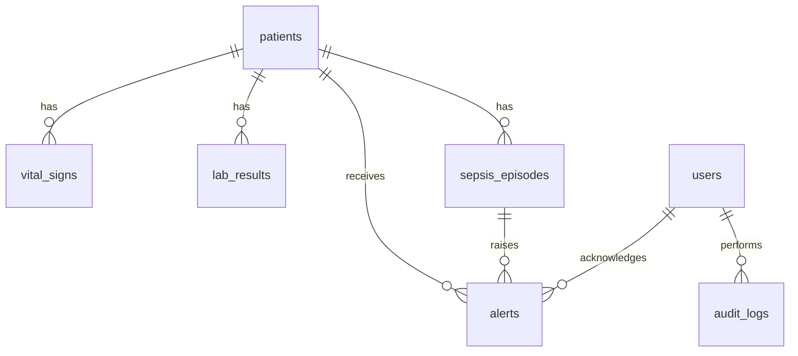

# Database schema

PostgreSQL 16, database `sepsis_db`. The authoritative DDL is `backend/sql/001_schema.sql`.

`ER_DIAGRAM.png`: in DBeaver, right-click the `public` schema -> **View Diagram**, then right-click the
canvas -> **Save as image** -> save as `docs/ER_DIAGRAM.png`.

## Integrity features

| Table | Constraints |
|---|---|
| users | UNIQUE(username), UNIQUE(email), CHECK role IN (admin, clinician, nurse) |
| patients | UNIQUE(mrn), CHECK gender, CHECK status |
| vital_signs | FK patient (ON DELETE CASCADE); CHECK ranges on all 7 measurements |
| lab_results | FK patient (CASCADE); CHECK ranges on all 8 measurements |
| sepsis_episodes | CHECK stage, outcome, confidence 0..1; partial UNIQUE index: one `ongoing` episode per patient |
| alerts | FK patient (CASCADE), FK episode (SET NULL), FK users; CHECK severity |
| audit_logs | FK users; JSONB details |

## Indexes

`idx_vitals_patient_time (patient_id, recorded_at DESC)`, `idx_labs_patient_time`,
`idx_episodes_patient`, `idx_alerts_unacked (acknowledged, created_at DESC)`, `idx_audit_entity`,
`ux_one_ongoing_episode`.

## Normalisation

Every table is in 3NF: measurements depend only on the reading's key (patient + time), episodes and
alerts reference patients by id, and no patient attributes are duplicated in child tables.

## Logic in the database

| Object | Purpose |
|---|---|
| `assess_sepsis(patient_id)` | Scores SIRS/qSOFA from the latest vitals and labs, creates or updates the episode |
| `raise_sepsis_alert(...)` | Inserts the alert and `pg_notify('alerts_channel', json)` |
| `trg_vitals_sepsis`, `trg_labs_sepsis` | AFTER INSERT: assess, then alert on a new episode or stage escalation |
| `trg_patients_updated_at` | BEFORE UPDATE: refresh `updated_at` |
| `trg_patients_audit` | AFTER INSERT/UPDATE: JSONB diff into `audit_logs` |
| `v_patient_current_status`, `v_active_alerts`, `v_sepsis_stats` | Reporting views (LATERAL joins) |
